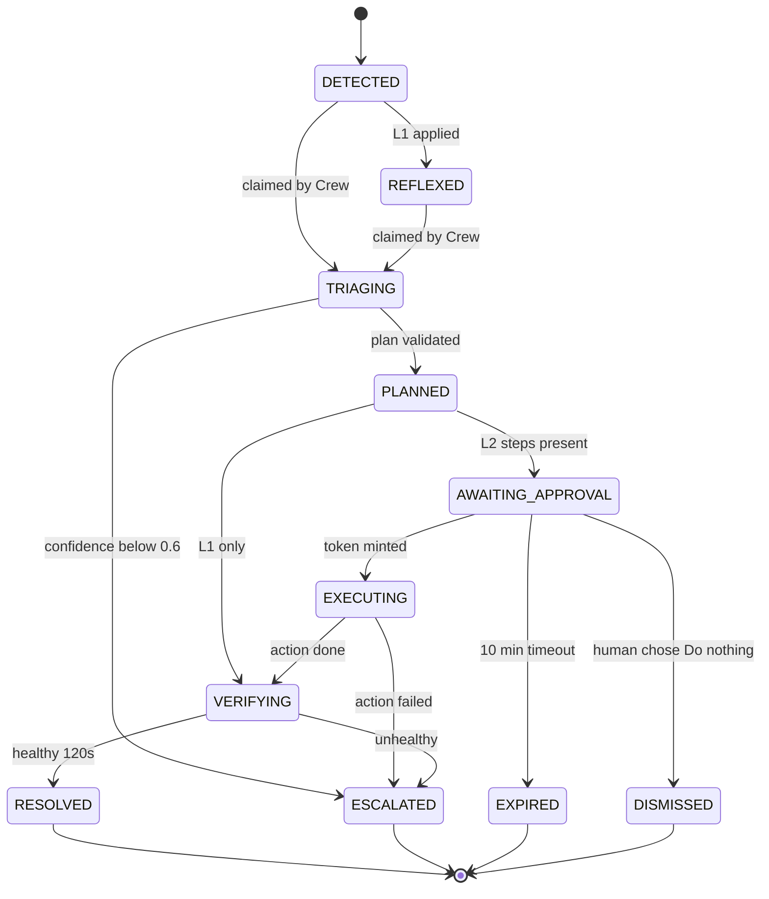

# Design Document — Server Incident Remediation

## Overview

Two-speed architecture:

- **Reflex path (milliseconds, deterministic, no LLM):** kernel signal → Sentinel detector → L1 reflex.
- **Reasoning path (seconds–minutes, Kiro Crew):** incident → Sentry triage → Architect spec + plan → policy validation → WhatsApp approval → Remediator execution → verification → postmortem.

The LLM is never in the hot path, and never holds authority: authority is a signed token only a human vote can mint.

## Components

| Component | Runtime | Responsibility |
|---|---|---|
| `internal/kernelfs` | Sentinel | Abstraction over `/sys/fs/cgroup` and `/proc` (fixture-testable) |
| `internal/psi` | Sentinel | PSI trigger registration + `poll(POLLPRI)` loop |
| `internal/cgroup` | Sentinel | `memory.current/max/high/events/stat` readers, inotify on `memory.events` |
| `internal/journal` | Sentinel | `journalctl --follow --output=json` stream, pattern matcher |
| `internal/systemd` | Sentinel | D-Bus client (`go-systemd/v22/dbus`): unit state, runtime properties, restart |
| `internal/detector` | Sentinel | EWMA slope, TTO, severity, hysteresis, debounce |
| `internal/reflex` | Sentinel | L1 actions with TTL scheduler and rollback |
| `internal/policy` | Sentinel | Action catalog, tier table, protected list, plan validation |
| `internal/approval` | Sentinel + wa-bridge | Ed25519 token mint (bridge) / verify + single-use nonce store (Sentinel) |
| `internal/executor` | Sentinel | Fixed-argv execution with timeouts |
| `internal/incident` | Sentinel | SQLite store (modernc), state machine, evidence, audit log |
| `internal/redact` | Sentinel | Redaction pipeline applied before evidence leaves the process |
| `internal/mcpserver` | Sentinel | MCP tools over Streamable HTTP (`modelcontextprotocol/go-sdk`) |
| `cmd/wa-bridge` | Brain | whatsmeow session, polls, vote decryption, heartbeat watch, MCP stdio tools |
| `franken-crew-app` | Brain | Kiro Crew app: 3 agents, skills, cron, dashboard page |

## Data Models

```text
Incident {
  id: string                 // INC-20261112-0317-pi01
  node: string
  cgroup: string             // /franken.slice/haunted-api.service
  severity: P1|P2|P3|POST_OOM
  state: IncidentState
  tto_seconds: number|null
  opened_at, updated_at, closed_at: RFC3339
  reflexes: ReflexAction[]
  evidence: EvidenceRef[]
  triage: Triage|null
  plan: Plan|null
}

Triage { class: enum, confidence: 0..1, evidence_ids: string[], summary: string }

Plan {
  incident_id: string
  suspected_root_cause: string
  options: PlanOption[]      // max 3 + implicit "Do nothing"
  human_follow_up: string[]
}
PlanOption { id: "A"|"B"|"C", label: string(≤ 60), steps: PlanStep[] }
PlanStep   { id: string, action: ActionName, params: object, evidence_ids: string[], expected_effect: string }

ApprovalToken (Ed25519 over canonical JSON) {
  incident_id, plan_hash, option_id, step_ids[], approver_hash, nonce, exp
}
```

## Incident State Machine



## Detection Model

- `slope = EWMA(Δmemory.current / Δt)` with α = 0.3 for a 1 s gap (1 Hz sampling); for any other gap Δt the weight is `1 − (1 − α)^(Δt / 1 s)`, and the slope updates only after a 250 ms minimum span, so event-driven samples cannot fake a steep slope.
- `limit = memory.max` if set, else host `MemTotal − reserve(64 MiB)`.
- `TTO = (limit − memory.current) / max(slope, 1 KiB/s)`; `null` when slope ≤ 0.
- Debounce: a cgroup cannot open a new incident within 5 min of closing the previous one; it re-opens the old one.

## Approval Protocol

1. Remediator calls `wa_request_approval(incident_id, plan_hash, options)`.
2. wa-bridge sends a poll; stores `option_hash → option_id` (SHA-256 of option text, as WhatsApp does).
3. Vote arrives → `DecryptPollVote` → allowlist check → token minted with the bridge's Ed25519 private key.
4. Remediator receives the token from `wa_await_decision` and passes it to `action_execute`.
5. Sentinel verifies signature (public key provisioned at install), binding (`plan_hash`, `step_ids`), expiry and nonce (single use).

The agent carries the token but cannot forge, widen or replay it.

## Error Handling

| Failure | Behaviour |
|---|---|
| PSI trigger write fails (EINVAL/EPERM) | Fall back to 1 Hz `avg10` polling for that cgroup, mark capability degraded, alert once |
| Cgroup removed (POLLERR) | Close watcher, re-discover in 5 s |
| SQLite busy | Retry with backoff (3×, 50/100/200 ms), then fail the call with `store_unavailable` |
| Executor timeout | Kill process group, record `timeout`, transition `ESCALATED` |
| MCP client disconnect mid-execution | Execution continues to completion; result stored and retrievable via `incident_get` |
| WhatsApp logged out | All L2 unapproved; Sentinel reflexes continue; Live Lab shows `bridge: offline` |

## Testing Strategy

- **Unit:** kernelfs fixtures for PSI/memory files; detector table tests; policy validation golden files.
- **Property-based (`pgregory.net/rapid`):**
  - P1: no plan containing an L3 action or protected target ever validates.
  - P2: a token for plan X never authorizes plan Y (any byte change in plan → reject).
  - P3: every applied L1 action is rolled back exactly once.
  - P4: `MemoryHigh` set by reflex is always ≥ `memory.current` at apply time.
- **Integration:** systemd-nspawn/VM with a real cgroup tree; `stress-ng` and the `haunted-api` leak app.
- **End-to-end chaos replay:** `franken chaos run leak-worker2` then assert state reaches `RESOLVED` with a test approver JID.

