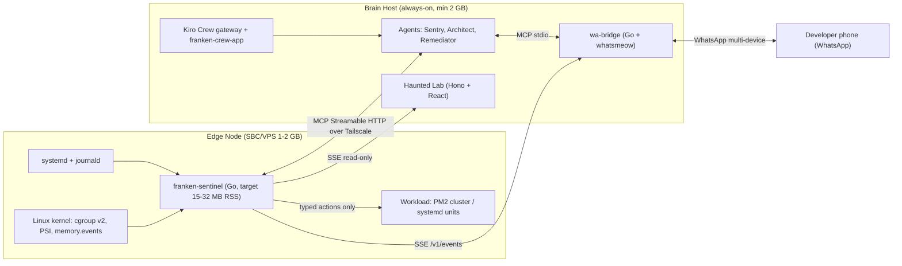
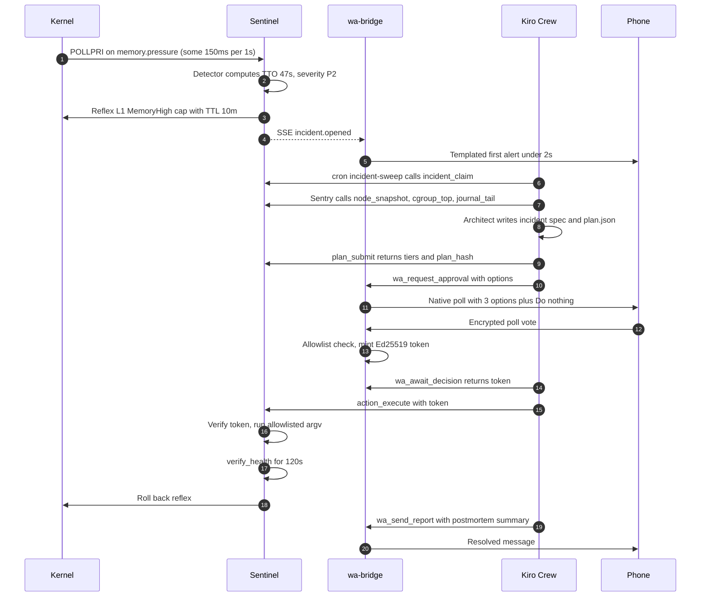

# FrankenCrew: The Resilient Server Sentry — Technical Blueprint

> Kiroween 2026 · Kategori **Frankenstein** · Target bonus: Best Kiro Crew App, Best Demo, Bonus Blog
> Deadline: **4 Des 2026 14:00 PT = 5 Des 2026 05:00 WIB**. Per 12 Nov tersisa ±22 hari kerja.

---

## 0. Temuan Kritis (Baca Sebelum Coding)

| #   | Asumsi di brief                                         | Realita (rules/docs)                                                                                                                                                                                                                                 | Keputusan                                                                                                                        |
| --- | ------------------------------------------------------- | ---------------------------------------------------------------------------------------------------------------------------------------------------------------------------------------------------------------------------------------------------- | -------------------------------------------------------------------------------------------------------------------------------- |
| 1   | "Kiro Crew" = sebutan untuk arsitektur multi-agent kita | **Kiro Crew adalah produk Kiro**: agent workspace persisten (gateway, cron, ACP ke `kiro-cli`, App Store, App Kit `app.json`). Bonus _Best Kiro Crew App_ mensyaratkan **repo terpisah** yang disubmit sebagai Crew app dengan akun GitHub yang sama | **Dua repo**: `franken-crew` (submission utama) + `franken-crew-app` (Crew app). 3 agent hidup di dalam Crew app                 |
| 2   | Kiro hooks dipicu event Linux                           | Kiro hooks dipicu event IDE/agent (file save, prompt submit, agent stop, pre/post tool use)                                                                                                                                                          | Bridge kernel → Crew kita bangun sendiri (Sentinel + cron sweep). Hooks dipakai untuk dev-time quality gate + runtime tool-audit |
| 3   | Steering = guardrail                                    | Steering hanyalah konteks prompt; LLM bisa melanggarnya                                                                                                                                                                                              | Enforcement di kode: typed actions (tanpa raw shell), policy tier, approval token Ed25519                                        |
| 4   | Agent yang merespons OOM                                | OOM bisa terjadi < 5 detik; loop LLM 20–90 detik                                                                                                                                                                                                     | Arsitektur **dua kecepatan**: Reflex deterministik (ms) + Crew reasoning (detik–menit)                                           |
| 5   | `.kiro/specs/server-incident-remediation.md`            | Kiro spec = folder berisi `requirements.md`, `design.md`, `tasks.md`                                                                                                                                                                                 | Sudah dibuat dalam format folder                                                                                                 |
| 6   | Video 100% animasi Remotion                             | Rules: < 3 menit, **wajib footage project berjalan**, tanpa trademark/musik pihak ketiga tanpa izin                                                                                                                                                  | Hybrid: Remotion me-render **data asli** (asciinema cast, log WA asli) + PiP rekaman layar asli. Tanpa logo WhatsApp             |
| 7   | Tombol interaktif WhatsApp                              | whatsmeow = protokol unofficial; button message sering tampil "not supported"; ada risiko banned                                                                                                                                                     | **Native Poll** (`BuildPollCreation` + `DecryptPollVote`) + fallback kode teks. Pakai **nomor khusus**, bukan nomor pribadi      |
| 8   | Kill zombie, drop cache                                 | Zombie sudah mati → tidak bisa di-kill, harus di-reap parent. `drop_caches` global, memicu IO storm, jarang mencegah OOM                                                                                                                             | Zombie → `zombie_reap(parent)` (L2). `drop_caches` **dilarang**, diganti `memory.reclaim` per-cgroup (kernel ≥ 5.19)             |
| 9   | —                                                       | Submission meminta URL aplikasi yang bisa diakses juri                                                                                                                                                                                               | **Haunted Lab**: dashboard publik read-only dari node demo asli                                                                  |
| 10  | —                                                       | Skema hook & `app.json` masih berkembang                                                                                                                                                                                                             | Buat hooks lewat panel Kiro (skema dijamin valid); cek App Kit docs pada M0                                                      |

> [!WARNING]
> Pitfall SBC: beberapa kernel (termasuk distro SBC tertentu) dikompilasi dengan PSI _disabled by default_. Cek `cat /proc/pressure/memory`. Jika tidak ada, tambahkan `psi=1` ke kernel cmdline (mis. `/boot/firmware/cmdline.txt`) lalu reboot. Pastikan juga cgroup v2 aktif: `stat -fc %T /sys/fs/cgroup` harus `cgroup2fs`.

---

## A. Domain & Data Flow Architecture

### A.1 Topologi



**Kenapa dua host:** node yang sedang OOM tidak boleh menjadi satu-satunya tempat "otak" dan jalur alert. Satu Brain menjaga banyak Edge (fleet). Mode single-host (Edge = Brain, RAM ≥ 2 GB) tetap didukung karena Sentinel melindungi dirinya dan Crew via `MemoryMin` + `OOMScoreAdjust`.

### A.2 Dua Kecepatan

| Jalur     | Latensi     | Pelaku                       | Otoritas                   |
| --------- | ----------- | ---------------------------- | -------------------------- |
| Reflex    | 1–250 ms    | Sentinel (Go, deterministik) | Hanya L1 (reversible, TTL) |
| Reasoning | 30–90 detik | Kiro Crew (3 agent)          | L0 + mengusulkan L2        |
| Decision  | detik–menit | Manusia via WhatsApp poll    | Mint token L2              |

### A.3 Alur Event End-to-End



### A.4 Detail Per Tahap

**1) Sinyal kernel**

| Sumber                          | Mekanisme                                                                     | Latensi | Kegunaan                                                                           |
| ------------------------------- | ----------------------------------------------------------------------------- | ------- | ---------------------------------------------------------------------------------- |
| `<cgroup>/memory.pressure`      | PSI trigger `some 150000 1000000` + `poll(POLLPRI)`                           | < 10 ms | Deteksi stall paling awal                                                          |
| `/proc/pressure/memory`         | PSI trigger host-wide                                                         | < 10 ms | Tekanan global / swap thrash                                                       |
| `<cgroup>/memory.events`        | inotify `IN_MODIFY` (kernel memicu file-modified event saat nilai berubah)    | < 10 ms | `high`, `max`, `oom`, `oom_kill`                                                   |
| `memory.current`, `memory.stat` | Sampling 1 Hz                                                                 | 1 s     | Slope EWMA → TTO, anon vs file                                                     |
| journald                        | `journalctl --follow --output=json` (subprocess, menghindari cgo `sdjournal`) | ~100 ms | Pola: `Out of memory`, `ENOMEM`, `JavaScript heap out of memory`, PM2 restart loop |
| systemd D-Bus                   | `go-systemd/v22/dbus` (pure Go)                                               | event   | State unit, `NRestarts`                                                            |
| `/proc/*/stat`                  | Scan 10 s                                                                     | 10 s    | Zombie (state `Z`) dikelompokkan per PPID                                          |

> [!NOTE]
> PSI trigger hanya hidup selama file descriptor terbuka. Root boleh window 500 ms–10 s; non-root wajib kelipatan 2 s. Sentinel berjalan sebagai root (tersandbox systemd), jadi window 1 s aman.

**2) Detector**

$$TTO = \frac{M_{limit} - M_{current}}{\max(\dot{M}_{ewma},\ 1\ \text{KiB/s})}$$

`M_limit` = `memory.max` cgroup, atau `MemTotal − 64 MiB` untuk host. `α = 0.3`, sampling 1 Hz.

| Severity | Kondisi (salah satu)                                          | Respons                                   |
| -------- | ------------------------------------------------------------- | ----------------------------------------- |
| P3       | PSI `some avg10 ≥ 10` selama 30 s, atau TTO < 300 s           | Catat, masuk morning digest               |
| P2       | PSI `some avg10 ≥ 25` atau `full avg10 ≥ 5`, atau TTO < 120 s | Reflex L1 + incident + alert              |
| P1       | TTO < 30 s, atau `memory.events` `max`/`oom` bertambah        | Reflex L1 + alert segera + Crew prioritas |
| POST_OOM | `oom_kill` bertambah                                          | Forensic mode + postmortem                |

Hysteresis: incident tutup bila setengah threshold bertahan 120 s. Debounce: cgroup yang sama dalam 5 menit me-reopen incident lama.

**3) Reflex (L1)** — maksimal satu aksi dalam 250 ms, maksimal 3 per incident, semua punya TTL dan rollback:

- `cgroup_throttle`: `systemctl set-property --runtime <unit> MemoryHigh=<current+5%>` → memperlambat pertumbuhan leak tanpa membunuh.
- `cgroup_reclaim`: tulis `memory.reclaim` (≤ 25% `memory.current`) → buang page cold milik cgroup itu saja.
- `admission_close`: tulis `/run/franken/<app>/admission` → middleware app menolak request non-kritis (503 + `Retry-After`).

**4) Incident & evidence** — ID `INC-20261112-0317-pi01`, evidence ber-`evidence_id`, **redaction di dalam Sentinel** (IP, email, nomor HP, bearer/JWT, string mirip key) sebelum data menyentuh LLM.

**5) Dispatch ke Crew** — Kiro Crew cron `incident-sweep` (`* * * * *`) memanggil `incident_claim` (atomik, mencegah dobel klaim). Latensi ≤ 60 s dapat diterima karena Reflex sudah menahan kerusakan; manusia sudah menerima first alert dalam < 2 s dari wa-bridge.

> [!TIP]
> Saat M0 cek App Kit docs: jika Crew menyediakan API/CLI "run now" untuk cron atau session, wa-bridge memanggilnya saat menerima SSE `incident.opened` sehingga latensi triage turun ke ~0. Cron tetap sebagai safety net.

**6) Crew pipeline**

| Agent                   | Tools                                                                                                                                  | Output                                                                 |
| ----------------------- | -------------------------------------------------------------------------------------------------------------------------------------- | ---------------------------------------------------------------------- |
| `franken-sentry` (lead) | `@sentinel` read-only: `incident_claim`, `node_snapshot`, `psi_history`, `cgroup_top`, `journal_tail`, `process_tree`, `zombie_report` | `triage.json`: 1 class, confidence, `evidence_ids`                     |
| `franken-architect`     | `read` (steering, skills), `write` (dibatasi ke `incidents/**`), `@sentinel/plan_submit`                                               | `incidents/<id>/requirements.md`, `design.md`, `tasks.md`, `plan.json` |
| `franken-remediator`    | `@sentinel/action_execute`, `action_rollback`, `verify_health`, `incident_transition`, `@wa/*`                                         | Eksekusi, verifikasi, `postmortem.md`                                  |

Tidak ada agent yang punya tool `shell`.

**7) Protokol approval (inti keamanan)**

1. wa-bridge mengirim poll; menyimpan `option_hash → option_id` (WhatsApp mengirim vote sebagai SHA-256 teks opsi).
2. Vote masuk → `DecryptPollVote` → cek allowlist JID → mint token Ed25519 `{incident_id, plan_hash, option_id, step_ids, approver_hash, nonce, exp=10m}`.
3. Remediator membawa token ke `action_execute`; Sentinel verifikasi signature (public key), binding, expiry, nonce single-use.
4. **Agent membawa token, tapi tidak bisa memalsukan, memperluas, atau me-replay-nya.** Ini cerita kuat untuk juri.

**8) Execute & verify** — argv template fix (`runuser -u <owner> -- pm2 reload <app>` dengan `PM2_HOME` dari config), timeout per aksi, kill process group saat timeout. Healthy = PSI `some avg10 < 5` & `full avg10 < 1` selama 120 s + unit `active` + HTTP probe 2xx + tanpa `oom_kill` baru.

**9) Close** — rollback reflex, state `RESOLVED`, ringkasan WA, `postmortem.md`, audit log append-only.

### A.5 MCP Surface

| Server     | Transport                                                                                                                                                                      | Tools                                                                                                                                                                                                                                                     |
| ---------- | ------------------------------------------------------------------------------------------------------------------------------------------------------------------------------ | --------------------------------------------------------------------------------------------------------------------------------------------------------------------------------------------------------------------------------------------------------- |
| `sentinel` | Streamable HTTP di interface Tailscale + bearer; diakses agent lewat proxy stdio `franken mcp connect sentinel@<node>` (token dibaca dari file 0600, tidak pernah ada di JSON) | Read: `node_snapshot`, `incident_list`, `incident_get`, `incident_claim`, `psi_history`, `cgroup_top`, `journal_tail`, `process_tree`, `zombie_report`. Write: `plan_submit`, `action_execute`, `action_rollback`, `incident_transition`, `verify_health` |
| `wa`       | stdio (`wa-bridge mcp`)                                                                                                                                                        | `wa_notify`, `wa_request_approval`, `wa_await_decision`, `wa_send_report`                                                                                                                                                                                 |

Prinsip: **tools adalah kata kerja bertipe**, bukan terminal. Ini sekaligus jawaban kebutuhan "MCP untuk terminal" — terminal tidak pernah diekspos mentah.

### A.6 Degraded Modes

| Kegagalan                     | Perilaku                                                                          |
| ----------------------------- | --------------------------------------------------------------------------------- |
| Brain mati                    | Sentinel tetap reflex, incident diantrikan lokal, dikirim saat Brain kembali      |
| Edge mati total               | wa-bridge kehilangan 3 heartbeat (15 s) → alert `node silent` (dead man's switch) |
| WhatsApp logout/putus         | Semua L2 dianggap tidak disetujui; Haunted Lab menampilkan `bridge: offline`      |
| PSI trigger gagal didaftarkan | Fallback polling `avg10` 1 Hz, capability ditandai degraded                       |
| LLM/Crew error                | Incident tetap `REFLEXED`, TTL rollback berjalan, eskalasi ke manusia             |

### A.7 Snippet Inti: PSI Trigger (Go)

```go
// WatchPSI mendaftarkan PSI trigger pada file pressure dan mengirim event setiap kali threshold terlampaui.
func WatchPSI(ctx context.Context, pressurePath string, stallUs, windowUs int, out chan<- PressureEvent) error {
	fd, err := unix.Open(pressurePath, unix.O_RDWR|unix.O_NONBLOCK|unix.O_CLOEXEC, 0)
	if err != nil {
		return fmt.Errorf("open %s: %w", pressurePath, err)
	}
	defer unix.Close(fd)

	// Format trigger: "<some|full> <stall_us> <window_us>"; trigger aktif selama fd terbuka
	if _, err := unix.Write(fd, []byte(fmt.Sprintf("some %d %d", stallUs, windowUs))); err != nil {
		return fmt.Errorf("register psi trigger %s: %w", pressurePath, err)
	}

	fds := []unix.PollFd{{Fd: int32(fd), Events: unix.POLLPRI}}
	for {
		if ctx.Err() != nil {
			return nil
		}
		// Timeout 1 detik supaya pembatalan context tetap terdeteksi
		n, err := unix.Poll(fds, 1000)
		if err != nil {
			if errors.Is(err, unix.EINTR) {
				continue
			}
			return fmt.Errorf("poll psi %s: %w", pressurePath, err)
		}
		if n == 0 {
			continue
		}
		// POLLERR berarti cgroup sudah dihapus; caller wajib re-discover
		if fds[0].Revents&unix.POLLERR != 0 {
			return ErrCgroupGone
		}
		if fds[0].Revents&unix.POLLPRI != 0 {
			select {
			case out <- PressureEvent{Path: pressurePath, At: time.Now()}:
			case <-ctx.Done():
				return nil
			}
		}
	}
}
```

---

## B. Spesifikasi Folder `/.kiro`

### B.1 Struktur Repo Utama (`franken-crew`)

```text
.kiro/
├── steering/
│   ├── product.md            inclusion: always   — visi, persona, non-goals
│   ├── tech.md               inclusion: always   — stack, versi, build flags
│   ├── structure.md          inclusion: always   — layout repo, konvensi penamaan
│   ├── rules.md              inclusion: always   — guardrails (SUDAH DIBUAT)
│   ├── linux-kernel.md       inclusion: fileMatch "internal/{psi,cgroup,kernelfs}/**"
│   ├── whatsmeow.md          inclusion: fileMatch "cmd/wa-bridge/**"
│   ├── remotion.md           inclusion: fileMatch "apps/video/**"
│   └── incident-response.md  inclusion: manual   — playbook untuk sesi debugging manual
├── specs/
│   ├── server-incident-remediation/   (SUDAH DIBUAT: requirements, design, tasks)
│   ├── sentinel-telemetry/
│   ├── wa-approval-bridge/
│   ├── crew-app/
│   ├── haunted-lab/
│   ├── demo-video/
│   └── incident-INC-DEMO-0001/        contoh spec hasil generate Architect saat runtime
├── hooks/                             dibuat via panel Agent Hooks Kiro
├── agents/
│   ├── franken-sentry.json
│   ├── franken-architect.json
│   └── franken-remediator.json
└── settings/
    └── mcp.json
```

File yang sudah dibuat:

- [rules.md](../.kiro/steering/rules.md)
- [requirements.md](../.kiro/specs/server-incident-remediation/requirements.md)
- [design.md](../.kiro/specs/server-incident-remediation/design.md)
- [tasks.md](../.kiro/specs/server-incident-remediation/tasks.md)

> [!IMPORTANT]
> Isi `.kiro/` ditulis dalam bahasa Inggris karena dibaca juri dan agent. Jangan pernah memasukkan `.kiro/` ke `.gitignore` — itu langsung diskualifikasi.

### B.2 Hooks (Dev-Time Quality Gates)

| Hook             | Trigger                                                        | Aksi                                                                                              |
| ---------------- | -------------------------------------------------------------- | ------------------------------------------------------------------------------------------------- |
| `policy-sync`    | File save `.kiro/steering/rules.md` atau `policy/actions.yaml` | Agent memastikan tabel action di rules.md == `actions.yaml`, lalu `go test ./internal/policy/...` |
| `executor-guard` | File save `internal/executor/**/*.go`                          | Tolak `exec.Command("sh"`, `bash -c`, `os.Remove`; jalankan property tests P1–P4                  |
| `schema-codegen` | File save `schema/*.schema.json`                               | Regenerate Go structs + Zod types, typecheck                                                      |
| `spec-task-sync` | Agent Stop                                                     | Centang task di `tasks.md` yang sudah lulus test, update `CHANGELOG.md`                           |
| `scene-still`    | File save `apps/video/src/scenes/**`                           | `npx remotion still` frame tengah scene untuk review visual                                       |
| `redaction-test` | File save `internal/redact/**`                                 | Jalankan corpus test redaction (IP, JWT, nomor HP)                                                |

Runtime hook di agent config: `preToolUse` pada `@sentinel/action_execute` → `franken guard --audit` (menulis audit, exit code non-zero memblok tool).

### B.3 Contoh Agent Config

```json
{
  "name": "franken-architect",
  "description": "Turns a triaged incident into a policy-compliant remediation spec and plan.json.",
  "prompt": "You are the FrankenCrew Architect. Read the triage, follow .kiro/steering/rules.md strictly, use only catalog actions, cite evidence_ids for every step, and write the incident spec into incidents/<id>/. If confidence < 0.6, produce an observe + escalate plan.",
  "tools": ["read", "write", "@sentinel"],
  "allowedTools": [
    "read",
    "@sentinel/incident_get",
    "@sentinel/node_snapshot",
    "@sentinel/plan_submit"
  ],
  "toolsSettings": { "write": { "allowedPaths": ["incidents/**"] } },
  "resources": [
    "file://.kiro/steering/rules.md",
    "file://.kiro/steering/incident-response.md"
  ],
  "mcpServers": {
    "sentinel": {
      "command": "franken",
      "args": ["mcp", "connect", "sentinel@pi01"]
    }
  }
}
```

Validasi field terhadap schema agent config resmi Kiro CLI saat M0 (nama tool built-in bisa berubah antar versi).

### B.4 `settings/mcp.json` (untuk sesi Kiro IDE saat development)

```json
{
  "mcpServers": {
    "sentinel": {
      "command": "franken",
      "args": ["mcp", "connect", "sentinel@pi01"],
      "autoApprove": [
        "node_snapshot",
        "incident_list",
        "incident_get",
        "psi_history",
        "cgroup_top"
      ]
    },
    "wa": {
      "command": "wa-bridge",
      "args": ["mcp", "--dry-run"],
      "disabled": false
    }
  }
}
```

### B.5 Repo Kedua: `franken-crew-app` (Kiro Crew App)

```text
franken-crew-app/
├── app.json                 manifest (name, agents, skills, ui.pages, permissions)
├── agents/                  3 agent (disinkronkan dari repo utama via `task sync:crew-app`)
├── skills/
│   ├── linux-memory-forensics/SKILL.md
│   ├── remediation-runbooks/SKILL.md
│   └── incident-spec-writer/SKILL.md
├── ui/                      halaman dashboard "Graveyard" (@kirocrew/app-sdk): vitals node, timeline incident, transcript agent
├── crons/                   incident-sweep (* * * * *), morning-digest (0 7 * * *)
└── README.md                install, screenshot, link ke repo utama
```

---

## C. Framework & Stack Selection

| Layer                | Pilihan                                                                                                                           | Alasan                                                                         |
| -------------------- | --------------------------------------------------------------------------------------------------------------------------------- | ------------------------------------------------------------------------------ |
| Telemetry + executor | **Go 1.23+**, `CGO_ENABLED=0`, `GOARCH=arm64/amd64`                                                                               | Static binary, RSS kecil, cross-compile dari Windows                           |
| Kernel access        | `golang.org/x/sys/unix` (poll, inotify), `github.com/prometheus/procfs`                                                           | Akses langsung tanpa cgo                                                       |
| systemd              | `github.com/coreos/go-systemd/v22/dbus`                                                                                           | Pure Go; journal via `journalctl -o json` subprocess (hindari cgo `sdjournal`) |
| Storage              | `modernc.org/sqlite`                                                                                                              | SQLite tanpa cgo, dipakai Sentinel dan wa-bridge                               |
| MCP                  | `github.com/modelcontextprotocol/go-sdk`                                                                                          | SDK resmi; stdio + Streamable HTTP                                             |
| WhatsApp             | `go.mau.fi/whatsmeow` + sqlstore (driver `sqlite`, DSN wajib `_pragma=foreign_keys(1)`)                                           | Satu-satunya library multi-device matang; poll support                         |
| Kripto approval      | `crypto/ed25519` (stdlib)                                                                                                         | Tanpa dependency                                                               |
| Property test        | `pgregory.net/rapid`                                                                                                              | Membuktikan invariant keamanan                                                 |
| Agents runtime       | **Kiro Crew** + `kiro-cli` (custom agents, cron, ACP)                                                                             | Wajib untuk bonus, persisten, background                                       |
| Network              | Tailscale                                                                                                                         | MCP remote tanpa membuka port publik                                           |
| Haunted Lab          | **Hono** (Node 22) + React + Vite + SSE, dipublikasi via Cloudflare Tunnel dari Brain                                             | Satu-satunya tempat Hono dipakai; edge tetap tanpa Node                        |
| Shared schema        | JSON Schema → Go (`go-jsonschema`) + Zod                                                                                          | Satu sumber kebenaran untuk Incident/Plan                                      |
| Video                | **Remotion 4** + React + TypeScript, `@remotion/transitions`, `@remotion/google-fonts`, `@remotion/media-parser`, `shiki`         | Video sebagai kode, deterministik                                              |
| Voiceover            | Amazon Polly Neural + **speech marks** (timestamp per kata)                                                                       | Sinkronisasi frame-precise, bisa diregenerasi saat naskah berubah              |
| Chaos                | `stress-ng`, `haunted-api` (Node + PM2 cluster dengan endpoint leak sengaja), `systemd-run --slice=franken.slice`                 | Demo bisa direproduksi                                                         |
| Monorepo             | pnpm workspace + `go.work` + Taskfile (go-task)                                                                                   | Cross-platform (Windows dev, Linux target)                                     |
| CI                   | GitHub Actions: `go test -race`, `golangci-lint`, `govulncheck`, GoReleaser (arm64/amd64), `pnpm typecheck`, Remotion still smoke | Bukti kualitas untuk juri                                                      |

**Yang sengaja tidak dipakai:** Fastify/Hono di edge (menambah runtime Node ±40 MB di box yang sedang kehabisan RAM), Docker di edge, Python, `drop_caches`, button message WhatsApp.

### C.1 Layout Repo Utama

```text
franken-crew/
├── .kiro/
├── cmd/{sentinel,wa-bridge,franken}/
├── internal/{kernelfs,psi,cgroup,journal,systemd,detector,reflex,policy,executor,approval,incident,redact,mcpserver}/
├── policy/actions.yaml
├── schema/{incident,plan,triage}.schema.json
├── apps/{live-lab,video}/
├── chaos/{haunted-api,scenarios}/
├── deploy/{systemd,install.sh}
├── docs/{BLUEPRINT.md,blog/}
├── LICENSE (MIT) · README.md · documentation.md · documentation-api.md
```

### C.2 Unit systemd Sentinel

```ini
[Unit]
Description=FrankenCrew Sentinel
After=network-online.target

[Service]
Type=notify
ExecStart=/usr/local/bin/franken-sentinel --config /etc/franken/sentinel.yaml
Restart=always
RestartSec=2
WatchdogSec=30
OOMScoreAdjust=-900
MemoryMin=48M
MemoryMax=96M
CPUWeight=200
NoNewPrivileges=yes
ProtectSystem=strict
ProtectHome=yes
PrivateTmp=yes
ReadWritePaths=/sys/fs/cgroup /var/lib/franken /run/franken

[Install]
WantedBy=multi-user.target
```

---

## D. Definition of Done

### D.1 Compliance (Hard Gate — gagal satu = diskualifikasi)

- [ ] Repo GitHub publik, `LICENSE` MIT terlihat di halaman About repo
- [ ] `/.kiro/` di root berisi `specs/`, `steering/`, `hooks/`, `agents/`, `settings/mcp.json`; tidak ada di `.gitignore`
- [ ] Video YouTube publik, **< 3:00** (target 2:30), memperlihatkan project berjalan di perangkat asli
- [ ] Video tanpa logo/trademark pihak ketiga dan tanpa musik berhak cipta (pakai musik berlisensi bebas/komposisi sendiri)
- [ ] URL aplikasi yang bisa diakses juri (Haunted Lab) + kredensial uji di field rahasia bila ada login
- [ ] Deskripsi Devpost menjelaskan **cara Kiro dipakai**: spec-driven, steering, hooks, MCP, Crew, perbandingan vibe vs spec
- [ ] Kategori Frankenstein dipilih; submit **paling lambat 3 Des** (buffer 1 hari)

### D.2 Bonus

- [ ] **Best Kiro Crew App:** repo `franken-crew-app` publik, dapat di-install di Kiro Crew, akun GitHub sama dengan repo utama, disubmit ke registry/App Store sesuai App Kit docs
- [ ] **Best Demo:** footage asli + storytelling (lihat E), audio bersih, caption terbakar
- [ ] **Blog:** artikel publik di dev.to/Medium/Hashnode yang menyebut Kiroween Hackathon, link dicantumkan di submission
- [ ] **Social Blitz:** post publik dengan hashtag resmi (cek halaman rules untuk hashtag 2026)

### D.3 Kualitas Teknis (Competitive Edge)

- [ ] Sentinel ≤ 32 MiB RSS dan ≤ 2% CPU di board ARM64 (angka terukur di README)
- [ ] Reflex ≤ 250 ms dari trigger (histogram dari 20 run chaos)
- [ ] 20 run chaos berturut-turut berakhir `RESOLVED` (leak, spike, fork storm, zombie storm, log flood)
- [ ] Property tests P1–P4 lulus di CI; badge CI hijau
- [ ] Token approval terbukti tidak bisa di-replay/diperluas (test + disebut di video)
- [ ] Spec contoh `incident-INC-DEMO-0001/` hasil generate Architect asli dikomit
- [ ] Install satu baris: `curl -fsSL .../install.sh | sudo bash` (script readable, idempotent)

### D.4 Peta ke Kriteria Juri

| Kriteria                            | Bukti yang kita tunjukkan                                                                                    |
| ----------------------------------- | ------------------------------------------------------------------------------------------------------------ |
| Potential Impact                    | Persona jelas (indie/homelab), biaya \$0, jalan di board 1–2 GB, alert di aplikasi yang sudah ada di HP      |
| Technological Implementation (Kiro) | 7 spec, 8 steering file dengan 3 mode inclusion, 6 hooks, 3 custom agent, 2 MCP server, Crew app + cron      |
| Quality/Creativity (Frankenstein)   | Kernel PSI × agent LLM × chat protocol — tiga dunia yang tidak pernah bertemu, dijahit dengan approval token |

---

## E. Storyboard & Scene Breakdown (Remotion)

### E.1 Spesifikasi Video

- 1920×1080, 30 fps, target **150 s = 4500 frame** (durasi akhir dihitung otomatis dari audio VO).
- Palet: void `#07060B`, toxic green `#39FF88`, pumpkin `#FF7A1A`, spectral purple `#A855F7`, alert red `#FF3B5C`, bone `#E8E6F0`.
- Font: JetBrains Mono (body/terminal), Creepster hanya untuk judul (keduanya OFL via `@remotion/google-fonts`).
- Footage asli wajib di S4, S6, S7 (PiP minimal 30% layar).

### E.2 Timeline

| Scene               | Waktu     | Frame     | Visual                                                                                                                              | Footage asli                        |
| ------------------- | --------- | --------- | ----------------------------------------------------------------------------------------------------------------------------------- | ----------------------------------- |
| S1 Cold Open        | 0:00–0:14 | 0–420     | Kamar gelap, jam digital 03:17, grafik memori merayap ke merah, glitch                                                              | —                                   |
| S2 Problem          | 0:14–0:27 | 420–810   | Board kecil tertimpa blok "enterprise agent 400 MB"; notifikasi Slack menumpuk tak terbaca                                          | —                                   |
| S3 The Stitch       | 0:27–0:43 | 810–1290  | Tiga "organ" (Kernel, Brain, Voice) dijahit jahitan neon hijau; petir; teks "IT'S ALIVE"                                            | —                                   |
| S4 Detect + Reflex  | 0:43–1:10 | 1290–2100 | Terminal render dari asciinema cast asli: `franken chaos summon leak`, PSI event, TTO 47s countdown, reflex 180 ms; grafik melandai | Video kamera board + layar terminal |
| S5 Crew Deliberates | 1:10–1:34 | 2100–2820 | 3 kartu agent dengan stream tool call; spec diketik (requirements → design → tasks); rules.md disorot "L2 needs a human"            | Rekaman Crew dashboard              |
| S6 The Phone        | 1:34–1:53 | 2820–3390 | Mockup chat generik (tanpa logo) dari log wa-bridge asli: alert → poll → vote; token Ed25519 "minted"                               | Rekaman layar HP (scrcpy)           |
| S7 Recovery         | 1:53–2:10 | 3390–3900 | PM2 reload, PSI turun, health ring hijau 120 s, reflex rollback, pesan "Resolved"                                                   | Terminal + Haunted Lab              |
| S8 Under the Hood   | 2:10–2:24 | 3900–4320 | Fly-through `.kiro/` tree, hooks firing, MCP tool list, Crew app                                                                    | Rekaman Kiro IDE                    |
| S9 Outro            | 2:24–2:30 | 4320–4500 | Logo FrankenCrew, URL repo, MIT, hashtag                                                                                            | —                                   |

### E.3 Naskah Voiceover (English, ±360 kata)

**S1 — Cold Open**

> Three seventeen A.M. Somewhere in a closet, a thirty-five-dollar server is running out of memory. In ninety seconds, the kernel will start killing things. And you? You're asleep.

**S2 — Problem**

> Indie hackers and homelabbers run real products on tiny boxes. Enterprise monitoring is too heavy to even install on them, and a Slack alert at 3 A.M. is a notification nobody reads.

**S3 — The Stitch**

> So we built a monster. FrankenCrew stitches together three parts that were never meant to meet: the Linux kernel's pressure signals, a crew of Kiro agents, and the chat app already on your phone. It's alive.

**S4 — Detect + Reflex**

> Watch. We unleash a memory leak on a real two-gigabyte ARM board. Our Sentinel, a tiny Go binary, subscribes to kernel pressure-stall triggers, so the kernel taps it on the shoulder the instant tasks start stalling. It predicts out-of-memory in forty-seven seconds, and within two hundred milliseconds applies a reversible reflex: it caps the leaking service's growth. No AI in the hot path. Just physics.

**S5 — Crew Deliberates**

> Now the Crew wakes up. The Sentry agent triages the evidence and calls it: a heap leak in worker two. The Architect reads our steering rules, then writes a real Kiro spec — requirements, design, and tasks — for the fix. Every step is checked against policy. Restarting a worker is tier two. That needs a human.

**S6 — The Phone**

> So it asks me. Not in a dashboard. In WhatsApp. A native poll, three choices, one tap. My vote mints a signed, single-use approval token, bound to this exact plan. The agents can carry it. They can never forge it.

**S7 — Recovery**

> The Remediator performs a graceful reload. Zero dropped requests. Pressure falls, the verifier waits two full minutes of green, and the reflex rolls itself back. Ninety-four seconds from stall to sleep. I never opened a laptop.

**S8 — Under the Hood**

> Everything was built spec-first with Kiro: steering files as guardrails, hooks that test every policy change, MCP servers for the kernel and the chat, and a Kiro Crew app that keeps watch while we sleep.

**S9 — Outro**

> FrankenCrew. Stitched from spare parts. Never sleeps. So you can.

> [!CAUTION]
> Angka di naskah (47 s, 200 ms, 94 s, "zero dropped requests") **wajib sama** dengan rekaman asli. Ukur dulu di M4, lalu sesuaikan naskah sebelum generate VO. Klaim yang tidak cocok dengan footage merusak kredibilitas di mata juri.

### E.4 Arsitektur Proyek Remotion

```text
apps/video/
├── src/
│   ├── Root.tsx                 registrasi Composition + calculateMetadata
│   ├── FrankenDemo.tsx          TransitionSeries visual + layer audio terpisah
│   ├── theme.ts
│   ├── timeline.ts              daftar scene, file VO, cue anchor
│   ├── scenes/S01ColdOpen.tsx … S09Outro.tsx
│   ├── components/
│   │   ├── CastTerminal.tsx     render asciinema cast (ANSI → span, auto-scroll)
│   │   ├── PhoneChat.tsx        mockup chat dari JSONL wa-bridge
│   │   ├── PollCard.tsx
│   │   ├── AgentCard.tsx        stream tool call
│   │   ├── SpecTyper.tsx        markdown typing + shiki highlight
│   │   ├── PressureGraph.tsx    grafik PSI/memory dari data asli
│   │   ├── StitchTransition.tsx custom presentation (jahitan neon)
│   │   └── Captions.tsx         caption per kata dari speech marks
│   └── lib/{cast.ts,ansi.ts,marks.ts,cues.ts}
├── public/{vo,casts,footage,data}/
└── scripts/{tts-polly.ts,export-wa-log.ts}
```

### E.5 Pipeline Sinkronisasi Frame-Precise

1. `timeline.ts` menyimpan naskah per scene dengan **cue anchor**, mis. `"...it predicts {cue:tto}out-of-memory..."`.
2. `scripts/tts-polly.ts` memanggil Polly 2× per scene dengan teks & voice identik: `OutputFormat=mp3` dan `OutputFormat=json` + `SpeechMarkTypes=["word","sentence"]`.
3. `calculateMetadata` membaca durasi MP3 (`parseMedia`) + speech marks → `durationInFrames` tiap scene = durasi VO + padding.
4. `cues.ts` mengubah cue anchor → frame absolut (`Math.round(ms / 1000 * fps)`), dipakai scene untuk memicu animasi tepat saat kata diucapkan.
5. Terminal: rekam di board dengan `asciinema rec --cols 110 --rows 30` memakai mode output `--plain` (line-oriented, tanpa redraw kursor TUI) agar renderer ANSI sederhana cukup.

```tsx
// Komposisi utama: visual memakai TransitionSeries, audio di layer terpisah agar tidak terpotong overlap transisi
export const FrankenDemo: React.FC<DemoProps> = ({
  scenes,
  transitionFrames,
}) => {
  return (
    <AbsoluteFill style={{ backgroundColor: theme.void }}>
      <TransitionSeries>
        {scenes.map((scene, i) => (
          <React.Fragment key={scene.id}>
            <TransitionSeries.Sequence
              durationInFrames={scene.durationInFrames}
            >
              <SceneRouter scene={scene} />
            </TransitionSeries.Sequence>
            {i < scenes.length - 1 ? (
              <TransitionSeries.Transition
                presentation={stitch()}
                timing={linearTiming({ durationInFrames: transitionFrames })}
              />
            ) : null}
          </React.Fragment>
        ))}
      </TransitionSeries>
      {scenes.map((scene) => (
        // startFrame dihitung di calculateMetadata dengan mengurangi overlap transisi kumulatif
        <Sequence
          key={`vo-${scene.id}`}
          from={scene.startFrame}
          durationInFrames={scene.durationInFrames}
        >
          <Audio src={staticFile(scene.voSrc)} />
        </Sequence>
      ))}
      <Captions scenes={scenes} />
    </AbsoluteFill>
  );
};
```

> [!WARNING]
> Pitfall Remotion: setiap `TransitionSeries.Transition` membuat dua scene **overlap** sehingga total durasi berkurang sebesar durasi transisi. Jika `<Audio>` diletakkan di dalam Sequence scene, VO dua scene akan bertabrakan. Karena itu audio ditaruh di layer terpisah dengan `startFrame` yang sudah dikoreksi.

> [!NOTE]
> Lisensi Remotion gratis untuk individu dan perusahaan ≤ 3 karyawan — tim hackathon aman. Render: `npx remotion render FrankenDemo out/demo.mp4 --codec=h264 --crf=18`.

### E.6 Checklist Produksi Video

- [ ] Rekam 5 take chaos lengkap; pilih take dengan angka paling representatif
- [ ] Blur nomor telepon & nama kontak di footage HP
- [ ] Mockup chat generik (warna sendiri, tanpa logo WhatsApp); nama WhatsApp cukup disebut di narasi
- [ ] Musik: komposisi sendiri atau royalty-free dengan lisensi tertulis; duck −14 dB di bawah VO
- [ ] Loudness akhir −14 LUFS (standar YouTube)
- [ ] Caption terbakar di video + upload SRT ke YouTube
- [ ] Tonton ulang di HP (juri sering menonton di layar kecil): teks minimal 36 px

---

## F. Roadmap Implementasi

Track A = Systems (Go/Linux). Track B = Agents, Crew App, Video, Writing.

| Fase               | Tanggal      | Track A                                                      | Track B                                                                                        | Exit criteria                                                 |
| ------------------ | ------------ | ------------------------------------------------------------ | ---------------------------------------------------------------------------------------------- | ------------------------------------------------------------- |
| M0 Foundation      | 12–13 Nov    | Repo, MIT, Go module, CI skeleton, capability probe di board | Daftar Devpost, baca rules final 2026, baca App Kit docs, steering lengkap, beli SIM khusus WA | `.kiro/` berisi steering + spec utama yang di-approve di Kiro |
| M1 Senses          | 14–18 Nov    | Task 1–4: kernelfs, PSI, inotify, journal, detector, store   | Spec `wa-approval-bridge`, `crew-app`; `haunted-api` chaos app                                 | `franken watch --plain` menampilkan TTO live saat `stress-ng` |
| M2 Reflex & Policy | 18–22 Nov    | Task 5–8: policy, executor, reflex, token, MCP server        | Task 9: wa-bridge (pairing, poll, vote, heartbeat)                                             | Reflex < 250 ms; vote menghasilkan token valid                |
| M3 Crew Loop       | 22–25 Nov    | Integrasi end-to-end, `verify_health`, postmortem            | Task 10: 3 agent, skills, cron, Crew app repo + dashboard; Haunted Lab                         | Satu incident nyata `DETECTED → RESOLVED` tanpa SSH           |
| M4 Harden & Record | 25–28 Nov    | Task 12: footprint benchmark, 20 run chaos, unit hardening   | Rekam asciinema, scrcpy, kamera board, Crew dashboard; ukur angka naskah                       | Semua checklist D.3 hijau; footage final tersedia             |
| M5 Story           | 28 Nov–2 Des | Bugfix, README, install script                               | Remotion S1–S9, VO Polly, blog draft, submit Crew app                                          | Video 2:30 ter-render, blog siap publish                      |
| M6 Ship            | 2–3 Des      | Tag release v1.0.0                                           | Publish blog + social post, isi Devpost, submit                                                | **Submitted 3 Des**; 4 Des hanya buffer                       |

> [!IMPORTANT]
> Jalur kritis: wa-bridge (risiko pairing/ban) dan Crew App (dokumentasi baru). Keduanya dimulai paling lambat M1 sebagai spike 1 hari agar blocker ketahuan lebih awal.

---

## G. Risk Register

| Risiko                                           | Dampak                                   | Mitigasi                                                                                                              |
| ------------------------------------------------ | ---------------------------------------- | --------------------------------------------------------------------------------------------------------------------- |
| Nomor WA terkena ban                             | Demo gagal                               | Nomor khusus, volume rendah (rate limit di rules), warm-up nomor beberapa hari sebelum demo, rekam footage lebih awal |
| `kiro-cli`/Kiro Crew tidak mendukung ARM64 Linux | Brain tidak bisa di SBC                  | Brain di mini PC/laptop always-on/VPS amd64; Edge tetap SBC (narasi fleet justru lebih kuat)                          |
| PSI disabled di kernel SBC                       | Deteksi dini hilang                      | Capability probe + `psi=1`; fallback polling `avg10`                                                                  |
| Skema hook/app.json berubah                      | File tidak valid                         | Generate hook via UI Kiro, validasi app di `kirocrew gateway` lokal                                                   |
| LLM menghasilkan plan invalid                    | Loop tanpa akhir                         | Max 2 revisi lalu eskalasi; policy engine yang memutuskan, bukan LLM                                                  |
| Video melebihi 3 menit                           | Juri berhenti menonton                   | `calculateMetadata` gagal-cepat jika total > 170 s                                                                    |
| Komentar kode berbahasa Indonesia di repo publik | Juri berbahasa Inggris kesulitan membaca | README, `.kiro/`, docs, commit message, nama identifier tetap bahasa Inggris                                          |
