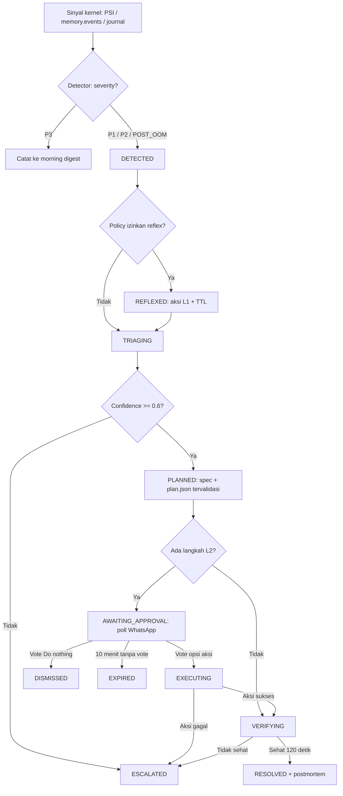

# FrankenCrew — Dokumentasi Logika Bisnis

> Status: **Rancangan** (belum diimplementasi). Sumber detail teknis: [docs/BLUEPRINT.md](docs/BLUEPRINT.md) dan [.kiro/specs/server-incident-remediation/](.kiro/specs/server-incident-remediation/).

## 1. Siklus Hidup Incident

## 2. Aturan Per Entitas

### 2.1 Node

| Field | Aturan | Catatan |
|---|---|---|
| name | Unik dalam fleet, huruf kecil | Dipakai di ID incident |
| status | HEALTHY / DEGRADED / CRITICAL / SILENT | Diturunkan dari severity incident aktif dan heartbeat |
| heartbeat | Interval 15 detik | 3 heartbeat hilang → SILENT |
| capabilities | psi, cgroup_v2, memory_reclaim | Tanpa PSI → Sentinel menolak start |

### 2.2 Incident

| Field | Aturan | Catatan |
|---|---|---|
| id | Format `INC-<yyyymmdd>-<hhmm>-<node>` | Unik, tidak berubah |
| severity | P1 / P2 / P3 / POST_OOM | P3 tidak membuat incident aktif |
| cgroup | Wajib, cgroup tersempit yang menjelaskan bukti | Blast radius minimal |
| tto_seconds | Null jika slope ≤ 0 | Dihitung dari EWMA 1 Hz |
| state | Lihat tabel transisi | Transisi hanya lewat state machine |
| reflexes | Maksimal 3 aksi L1 | Masing-masing punya TTL ≤ 15 menit |
| evidence | Setiap item punya `evidence_id` | Sudah diredaksi sebelum keluar Sentinel |

### 2.3 Evidence

| Field | Aturan | Catatan |
|---|---|---|
| evidence_id | Unik per incident | Wajib dikutip oleh setiap langkah plan |
| journal_lines | Maksimal 200 baris | IP, email, nomor HP, token, JWT diredaksi |
| psi_history | 10 menit terakhir | some/full avg10 |

### 2.4 Remediation Plan

| Field | Aturan | Catatan |
|---|---|---|
| options | Maksimal 3 + opsi implisit "Do nothing — I'll SSH in" | Label ≤ 60 karakter |
| steps.action | Hanya dari action catalog | Aksi L3 tidak pernah valid |
| steps.evidence_ids | Minimal 1 | Evidence before action |
| suspected_root_cause | Wajib | Restart bukan root cause |
| plan_hash | SHA-256 JSON kanonik | Perubahan 1 byte = plan berbeda |
| revisi | Maksimal 2 kali | Lewat batas → ESCALATED |

### 2.5 Approval

| Field | Aturan | Catatan |
|---|---|---|
| approver | Hanya JID di allowlist | Vote lain diabaikan dan diaudit |
| token | Ed25519, terikat incident_id + plan_hash + step_ids | Tidak bisa dipalsukan agent |
| exp | 10 menit | Re-ping sekali di menit ke-5 |
| nonce | Sekali pakai | Replay ditolak |

### 2.6 Reflex Action (L1)

| Field | Aturan | Catatan |
|---|---|---|
| jenis | cgroup_throttle / cgroup_reclaim / admission_close | Semua reversible |
| MemoryHigh | ≥ pemakaian saat ini, ≤ 95% RAM host | Membatasi pertumbuhan, bukan memaksa shrink |
| reclaim bytes | ≤ 25% memory.current | Per cgroup, bukan global |
| TTL | ≤ 15 menit | Rollback otomatis saat TTL habis atau incident RESOLVED |

## 3. Tabel Transisi Status

### 3.1 Incident

| Dari | Ke | Pemicu |
|---|---|---|
| — | DETECTED | Severity P1/P2/POST_OOM |
| DETECTED | REFLEXED | Aksi L1 diterapkan |
| DETECTED / REFLEXED | TRIAGING | Diklaim cron `incident-sweep` |
| TRIAGING | PLANNED | Plan lolos validasi policy |
| TRIAGING | ESCALATED | Confidence < 0.6 atau revisi plan habis |
| PLANNED | AWAITING_APPROVAL | Plan memuat langkah L2 |
| PLANNED | VERIFYING | Plan hanya L0/L1 |
| AWAITING_APPROVAL | EXECUTING | Token approval diterbitkan |
| AWAITING_APPROVAL | DISMISSED | Manusia memilih "Do nothing" |
| AWAITING_APPROVAL | EXPIRED | 10 menit tanpa vote |
| EXECUTING | VERIFYING | Aksi selesai sukses |
| EXECUTING | ESCALATED | Aksi gagal / timeout |
| VERIFYING | RESOLVED | Sehat selama 120 detik |
| VERIFYING | ESCALATED | Tidak sehat |

### 3.2 Approval

| Dari | Ke | Pemicu |
|---|---|---|
| — | PENDING | Poll terkirim |
| PENDING | GRANTED | Vote opsi aksi dari JID allowlist |
| PENDING | DENIED | Vote "Do nothing" |
| PENDING | EXPIRED | Lewat 10 menit |
| GRANTED | CONSUMED | Token dipakai `action_execute` |

### 3.3 Reflex Action

| Dari | Ke | Pemicu |
|---|---|---|
| — | APPLIED | Detector P1/P2 dan policy mengizinkan |
| APPLIED | ROLLED_BACK | Incident RESOLVED |
| APPLIED | EXPIRED_ROLLED_BACK | TTL habis |
| APPLIED | FAILED_ROLLBACK | Rollback gagal → alert manusia |

### 3.4 Node

| Dari | Ke | Pemicu |
|---|---|---|
| HEALTHY | DEGRADED | Incident P2 aktif |
| HEALTHY / DEGRADED | CRITICAL | Incident P1 / POST_OOM aktif |
| DEGRADED / CRITICAL | HEALTHY | Semua incident terminal |
| Semua | SILENT | 3 heartbeat hilang |
| SILENT | HEALTHY | Heartbeat kembali |

## 4. Batasan Bisnis & Trigger

| Kategori | Aturan |
|---|---|
| Otoritas | Aksi yang memutus koneksi, menghilangkan state, atau restart proses wajib vote manusia (L2) |
| Larangan mutlak | Raw shell, hapus file, reboot, ubah konfigurasi persisten, ubah `memory.max`, `drop_caches`, sentuh proses terlindungi |
| Proses terlindungi | PID 1, kernel thread, sshd, journald, logind, dbus, tailscaled, Sentinel, wa-bridge, Crew gateway |
| Eksekusi berantai | Maksimal 2 langkah L2 per satu approval; verifikasi setelah tiap langkah |
| Rate limit pesan | ≤ 6 pesan per incident, ≤ 20 pesan per jam per node |
| Quiet hours | 23:00–07:00: P3 ditunda ke digest pagi; P1/P2 selalu dikirim |
| Debounce | Cgroup yang sama dalam 5 menit me-reopen incident lama |
| Degraded | Brain mati → reflex tetap jalan, incident diantrikan; WhatsApp putus → semua L2 dianggap tidak disetujui |
| Trigger: first alert | SSE `incident.opened` → pesan templat < 2 detik |
| Trigger: triage | Cron `incident-sweep` setiap menit |
| Trigger: digest | Cron `morning-digest` pukul 07:00 waktu lokal |
| Trigger: postmortem | Incident mencapai state terminal |

